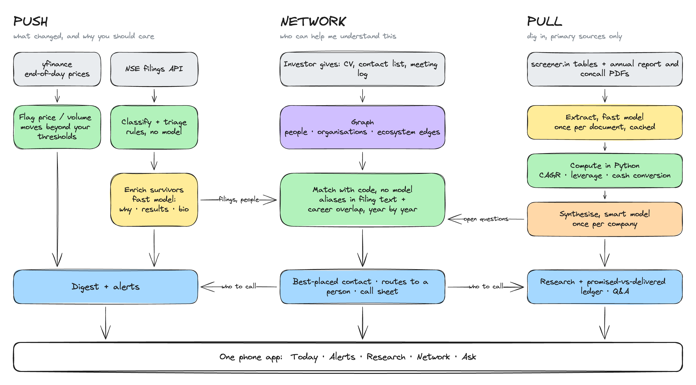
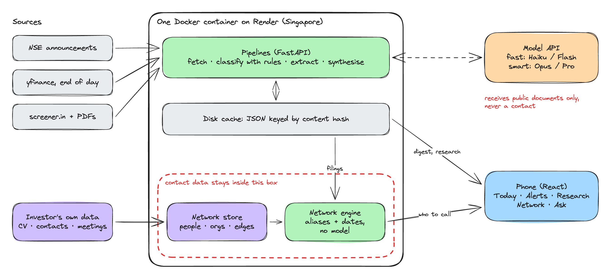

# FINN — a financial investment agent for Indian equities

Mobile-first prototype for the ENAM Founding AI Engineer Build Challenge.

**Live demo:** https://finn-10sm.onrender.com (open it on a phone; free tier, so the first open after idle takes a minute). Source: https://github.com/CinnamonRoll10/finn

FINN watches a portfolio of NSE-listed companies. It has two modes and one layer underneath both:

* **Push** — it tells you what changed and why you should care: a windowed digest of every exchange filing, triaged into *needs attention / worth a glance / routine (hidden)*, plus threshold alerts on end-of-day price and volume that *you* define.
* **Pull** — on-demand research on any NSE company, grounded only in primary sources (annual report + the last four earnings-call transcripts + standardised financials). Its centrepiece is a **promised-vs-delivered ledger**: what management guided on each call, against what the next quarter actually printed.

* **Network** — the investor's own contacts, matched against what just happened. A filing arrives with the one person best placed to explain it; a new CEO arrives with the routes to them and the evidence each route rests on; a week of filings becomes a **call sheet** of the three or four phone calls worth making.

Every pushed filing is a doorway into the research: *Ask FINN* on a card pre-loads a question about that filing against the company's fundamentals. And every filing that matters ends in a person.

## The Network

The point of view: filings tell you what management wants said. The fastest way to the rest is someone you already know, and most investors cannot see who that is. So the Network is not a tab of contacts; it shows up where the question arises.

| where | what it does |
|---|---|
| **Today**, on a filing | *In your network*: the one contact best placed to give context, why them, and what to ask. A filing about Novelis points to the person who did corporate development at Novelis, not just "someone from Hindalco". |
| **Today**, on a management change | *Routes to the appointee*: the person's career is read from the filing's own Reg-30 profile and compared with every contact's career, year by year. Each route says what it rests on ("Both at ICICI Bank 2017–2021") or says the dates are not in the filing and the overlap is unconfirmed. |
| **Today**, call sheet | The week's material filings turned into a ranked list of calls, including people going cold whose employer just gave you a reason to ring. Each comes with an opener you can copy. |
| **Alerts** | An unusual price or volume move with no filing behind it gets the contact who would know what is happening on the ground. |
| **Research → Who to call** | Contacts grouped by how they connect to the company: inside, alumni, competitors, suppliers, customers, sector. The open questions the research generated are handed to the people who could answer them. Works for tickers outside the demo set. |
| **Network** | A map with you at the centre: one ring per tie strength, a filled node where someone's employer filed this week. Expertise chips light up the map by theme. Blind spots lists holdings where you know nobody. |
| **Ask** | One box. "Who do I know at Swiggy?", "How do I reach Anup Bagchi?", "Go-to people for rural lending?" are answered from the graph; business questions go to the research. Voice input where the browser supports it. |

What it deliberately does not do: put a name on every row. Only attention-tier filings earn a person, weak links ("same college, year unknown") are dropped, and when nobody overlaps it says so. Current employees of a company you hold carry a caution not to ask for unpublished price-sensitive information.

**The data is synthetic.** `seed/network.json` holds 38 invented contacts (any resemblance to a real person is coincidental) built on real organisations so that they overlap with real filings. What the investor is assumed to give FINN: their own CV, a contact list with one line on how they know each person, and three years of meeting notes. In production the profile fields would come from the investor's own exports (their LinkedIn connections export, their CRM, their calendar) and from what people publish about themselves through a licensed data provider; not from scraping a platform against its terms.

## Run it

```bash
# backend
python3 -m venv .venv && .venv/bin/pip install -r requirements.txt
cp .env.example .env          # add ANTHROPIC_API_KEY or GEMINI_API_KEY (optional, see below)
.venv/bin/uvicorn backend.app:app --port 8000

# frontend (dev, with hot reload)   — or `npm run build` once and the API serves web/dist
cd web && npm install && npm run dev
```

Open http://localhost:5173 (dev) or http://localhost:8000 (built). It is laid out for a phone; on a desktop it renders as a phone-width column. To try it on your phone, run it on your laptop and open `http://<laptop-ip>:8000`, or `docker build -t finn . && docker run -p 8000:8000 --env-file .env -v finn-data:/data finn` and deploy the image anywhere (Render, Fly, Railway).

### Deploy

The repo ships a `seed/` snapshot of the warmed caches (research dossiers for 25 companies, transcript extractions, filing summaries; ~10 MB, no raw PDFs). On first start the app copies it into its data directory, so a fresh container is fully populated before it has made a single API call. Regenerate it with `scripts/make_seed.py` after `scripts/warm.py`.

* **Render** — `render.yaml` is a Blueprint: *New + → Blueprint → this repo*, then add `ANTHROPIC_API_KEY` or `GEMINI_API_KEY` under Environment. Free plan by default (sleeps when idle); switch to `starter` and uncomment the disk for an always-on demo that keeps caches across deploys.
* **Anywhere with Docker** — `docker build -t finn . && docker run -p 8000:8000 -e GEMINI_API_KEY=… finn`.

Pick a region near India if you can: NSE and screener.in are quicker, and less likely to rate-limit, from there.

Pre-build everything the demo touches so first open is instant:

```bash
.venv/bin/python scripts/warm.py             # digests + research for all 25 companies
.venv/bin/python scripts/warm.py POLYCAB      # one company
```

### Model providers

`backend/llm.py` picks a provider automatically:

| configured | fast tier (bulk extraction) | smart tier (synthesis / Q&A) |
|---|---|---|
| `ANTHROPIC_API_KEY` | `claude-haiku-5-5` | `claude-opus-5-5` |
| `GEMINI_API_KEY` | `gemini-flash-latest` | `gemini-pro-latest` |
| `claude` CLI logged in | haiku | opus (runs on a Claude subscription, zero API spend) |
| nothing | rule-based triage, numbers-only research |

Every model call is cached on a hash of its input, so a transcript is read once, ever. `/api/usage` reports calls, tokens and cost per model and per purpose.

## How it works



*Drawn in Excalidraw. Source: [`docs/how-it-works.excalidraw`](docs/how-it-works.excalidraw), which opens at [excalidraw.com](https://excalidraw.com).*

| step | module | model |
|---|---|---|
| Classify each filing into 17 categories and a base priority, from NSE's own type plus the subject line | `engine/classify.py` | none |
| Window filter, dedupe, mute, tier into attention / glance / routine | `engine/digest.py` | none |
| One-line headline and "why it matters" for survivors, twelve filings per call | `engine/enrich.py` | fast |
| Revenue, EBITDA, PBT, PAT from the results PDF; QoQ and YoY computed in Python, screener as fallback | `engine/enrich.py` | fast |
| Appointee profile from the Reg-30 disclosure | `engine/enrich.py` | fast |
| Volume against trailing average, price move against threshold | `sources/prices.py` | none |
| PDF to text; annual report cut to opening pages plus MD&A | `sources/docs.py` | none |
| Guidance, tone and themes per transcript; annual-report extraction | `engine/research.py` | fast |
| CAGRs, leverage, cash conversion, cash cycle, quarterly YoY | `engine/research.py` | none |
| Eight research sections, the promised-vs-delivered ledger, bull and bear, open questions; then Q&A | `engine/research.py` | smart |
| Organisations and years out of a filing's bio text; appointee's career against every contact's, year by year | `engine/network.py` | none |
| Best-placed contact per filing, call sheet, who to call for any ticker, direct questions | `engine/network.py` | none (a fast planner only when rules cannot route a question) |

Design choices worth knowing:

* **Rules first, model second.** NSE already types every filing. Regexes on that plus the subject line classify ~95 % of filings for free and decide what is routine. Only survivors get a (cheap) model call, batched twelve at a time.
* **Instant digest, background detail.** `/api/digest` assembles from caches and returns in milliseconds with `complete: false`; model work runs in a thread and the UI polls. A 15-minute warm loop keeps the default windows fresh.
* **Numbers are computed, not generated.** QoQ/YoY, CAGRs, leverage, cash conversion and the quarterly YoY table are all Python over screener's tables. The strong model sees a compact numbers block plus per-document extractions — never a 500-page PDF — and is told not to do arithmetic or use outside knowledge.
* **Management-change bios come from the filing.** SEBI's Reg-30 format mandates a brief profile of the appointee; that is more reliable than scraping LinkedIn and is still primary data.
* **The Network uses no model, by design.** Matching a name in a filing to a person, or a company to the people around it, is alias lookup and date arithmetic. That makes it instant, free, explainable to the last word, and it means no contact's details are ever sent to a model provider. The one model call in `network.py` is a fallback planner for questions the rules cannot route; it sees the question, theme names and company names.
* **Evidence over assertion.** A route to a person shows the overlap it rests on and is labelled unconfirmed when the filing gives no dates. Tie strength of a chain is the weaker of its two halves.
* **Thresholds are the user's.** Price-move %, volume multiple, lookback window and the filing categories that alert immediately are all editable in the Alerts tab and persist server-side.

## Architecture



*Drawn in Excalidraw. Source: [`docs/architecture.excalidraw`](docs/architecture.excalidraw).*

**Data pipelines.** Filings come from NSE's corporate-announcements API per symbol (cached per symbol and window, refreshed by a 15-minute warm loop), prices from yfinance at end of day, fundamentals from screener.in's standardised tables plus the annual-report and concall PDFs it links to. Everything is cached on disk as JSON keyed by a hash of its input, so a document is fetched and read once. Linking is by three keys: the NSE symbol ties filings, prices and research together; an alias table ties organisation names in free text ("ICICI Group", "Novelis", "HUL") to an organisation and, where listed, its symbol; people are matched on normalised names (titles stripped, fuzzy above 0.92) and then on career overlap by year. People named in filings are indexed per company so they can be asked about later.

**Data security and privacy.** The network is the sensitive part, so it is handled differently from everything else.
* *What is stored about a contact:* name, roles and employers with years, education, the investor's own one-line note on how they know them, a tie strength and a last-contact date. No phone numbers, emails, addresses, photos or message content.
* *Where it goes:* nowhere. Matching runs in-process; no contact field is sent to a model provider or any third party. Model calls carry only public documents (filings, transcripts, annual reports). The fallback planner receives the investor's typed question.
* *Retention and erasure:* contacts live until the investor removes them; **Forget** on any person erases them from every view at once (in the prototype it hides the seed row; in production it deletes the row and its derived edges). The index of people named in filings is derived from public disclosures and capped per company.
* *In a real deployment:* one logical store per investor with row-level security on `investor_id` and per-investor envelope encryption (KMS-held keys), so the firm's operators cannot browse a partner's contacts and there is no cross-investor graph unless two people explicitly share. SSO plus device-bound sessions; an append-only audit log of every read of a contact. Profile enrichment only from the investor's own exports and licensed providers, with source and date recorded per field. Under India's DPDP Act the contact is a data principal: FINN keeps a notice-and-erasure path, stores the minimum needed for the purpose (career facts, not private details), and hosts in-region. Current insiders are flagged so the tool never nudges anyone toward unpublished price-sensitive information.

**LLMs and agents.** Two tiers, routed by job. The fast tier (Claude Haiku 5.5 or Gemini Flash) does every bulk read: one-line filing summaries in batches of twelve, headline numbers from results PDFs, appointee profiles from Reg-30 filings, transcript and annual-report extraction. The smart tier (Claude Opus 5.5 or Gemini Pro) runs once per company to synthesise the research and answers follow-up questions over the cached extractions. Arithmetic is never delegated: growth rates, ratios and date overlaps are Python. There are no free-roaming agents. Two things act on their own: the digest pipeline (fetch, classify, summarise, enrich, on a timer) and the Ask router, which picks between two tools, the network graph and the research Q&A, with rules first and a cheap planner second. For a product that pushes to a portfolio manager, bounded pipelines that can be audited beat an agent loop that can wander.

**Cloud.** One Docker image on Render in Singapore (closest region to NSE and screener.in): FastAPI serves the API and the built React app, with a seed snapshot of warmed caches so a cold container is populated before its first API call. Models are called over their APIs. At real scale this splits into a scheduled ingestion worker, Postgres for filings and research, object storage for PDFs, a separate encrypted store for network data in an India region, and FCM/APNs for true push.

## Layout

```
backend/
  app.py            FastAPI: /api/digest /api/research/{sym} /api/ask /api/network* /api/settings /api/usage; serves web/dist
  config.py         demo portfolio (20) + research set (5), default thresholds
  llm.py            provider router, two tiers, content-addressed cache, usage ledger
  store.py          on-disk JSON/bytes cache + settings
  sources/          nse.py  prices.py  screener.py  docs.py
  engine/           classify.py  enrich.py  digest.py  research.py  network.py
seed/network.json   the mock network: 38 synthetic people, organisations with aliases, ecosystem edges
seed/cache/         warmed caches shipped with the image
web/src/            App.jsx  Today.jsx  Alerts.jsx  Research.jsx  Network.jsx  Ask.jsx  net.jsx  ui.jsx  styles.css
scripts/            warm.py (pre-build caches)  make_seed.py  export_history.py (AI build history)
docs/               README diagrams: Excalidraw sources and their PNG exports
build-history/      readable transcripts of the Claude Code sessions that built this
```

The engine is not tied to the demo lists: `/api/research/POLYCAB/build` works for any symbol screener.in knows, and `/api/network/company/{symbol}` finds contacts for any ticker: curated competitor and supply-chain edges where they exist, sector themes read from the company's description where they do not.

## Limits

* NSE's API needs a cookie handshake and occasionally rate-limits; failures are reported per symbol in the digest and retried on the next refresh. BSE's API blocks non-browser clients, so filings come from NSE only.
* Scanned-image PDFs yield no text; results then fall back to screener's standardised table once it has the quarter.
* Company-hosted transcript links on screener.in are sometimes dead or block scripts; FINN then looks for the copy the company filed with NSE. Companies that hold no earnings calls (e.g. ITC) get research from the annual report and numbers only.
* Malformed model JSON is retried with the parse error fed back; large PDF downloads are verified against Content-Length.
* Prices are end-of-day (yfinance), so price/volume alerts fire after close, not intraday.
* The network's link to a person in a filing is only as good as the profile in the filing. Where a Reg-30 disclosure gives no dates, FINN reports "same employer, unconfirmed" rather than guessing; where it names no prior employers, it says there is nothing to match.
* Competitor, supplier and customer edges are a small hand-written table for the demo companies. In production they would be extracted from annual reports (related parties, top customers) and maintained per company.
* Tie strength and last-contact dates are entered by hand in the mock data; a real deployment would infer them from calendar and email metadata with the investor's consent.
* The ledger judges guidance against reported numbers; where guidance is qualitative it judges direction and says so.
